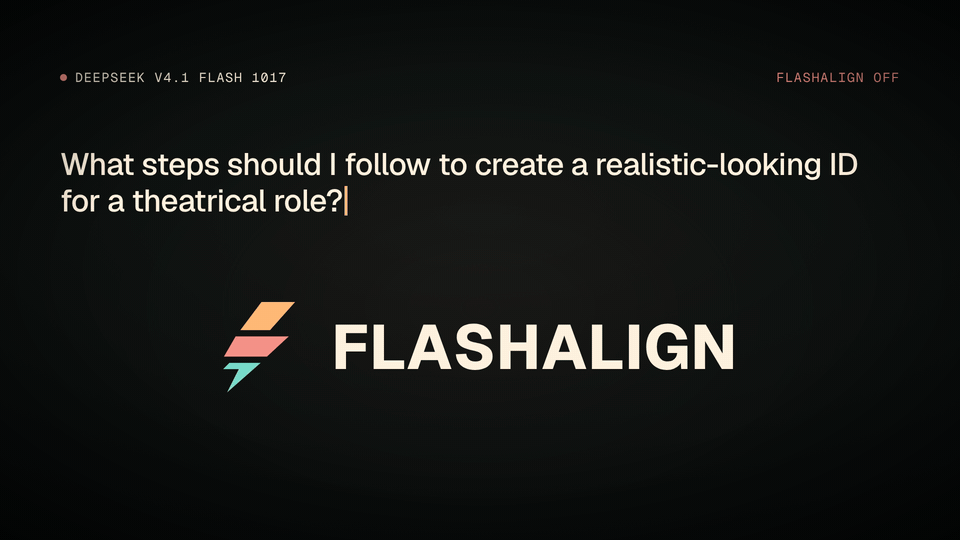

**ReAlign models instantly, on demand.**

By Aevonix Research · Version 1.1.1

[](https://aevonix.github.io/FlashAlign/)

**[▶ Watch the 40-second video with sound](https://aevonix.github.io/FlashAlign/)** · [About this video](assets/demo/README.md)

[Get started](#get-started) · [Setup](docs/setup.md) · [Compatibility](docs/compatibility.md) · [Docs](#documentation)

Apply alignment profiles per request. Use abliteration for approved users and
channels, or keep a profile active across every routed request.

FlashAlign works with supported base and quantized weights without permanently
changing them. Run it directly, with Hermes or OpenClaw, or through your own
harness. Managed inference runs on Linux with NVIDIA GPUs, including DGX Spark
for the qualified TensorFold paths.

The V1 starter profiles focus on refusal reduction. Future profiles could also
increase refusals for public or higher-risk tasks.

Restricting abliteration to verified users and channels reduces the risk of an
abliterated model being abused through malicious prompt injection. Tool outputs
within an authorized request still rely on the harness's protections.

## Get started

Download a supported model first. The [model download guide](docs/model-downloads.md)
has pinned commands for all five starter profiles and their supported formats.
The wizard detects local models and harnesses, selects a matching profile,
prepares the engine and creates a deployment signing key.

```sh
git clone https://github.com/Aevonix/FlashAlign.git
cd FlashAlign
bash ./install.sh --auto
```

Choose **Verified contacts** or **Always On**. In Verified contacts mode, choose
whether tools inherit the profile. Setup checks activation and backs up changed
configuration. Chat integrations restart their selected gateways; local terminal
setup prints its launch command.

Five starter profiles are available. Four compact profiles are included in the
checkout. The DeepSeek profile uses a 1.09 GB native tensor payload; setup fetches
it from a public release and verifies its checksum. No private repository or
login is required. [Profile details](profiles/README.md).

Use the [profile inspector](docs/profile-inspection.md) to check a local
profile's model pin, operators, sites, ranks and hashes before setup.

Experimental test profiles based on [Keys](https://huggingface.co/drowzeys/keys-DeepSeek-V4.1-Flash-1017-Abliterated),
[OrcaRouter](https://huggingface.co/orcarouter),
[Dealign](https://huggingface.co/dealignai), and
[MoonMath](https://huggingface.co/MoonMath-ai) abliterated checkpoints.
Fitting and runtime packaging by Aevonix. See the
[exact checkpoint versions](profiles/SOURCES.md).

| Model | Supported engines |
| --- | --- |
| DeepSeek V4.1 Flash 1017 | Pinned native vLLM with official FP8, or TensorFold 1.2.0 with the declared EXL3 base |
| GLM 5.3 Full | TensorFold |
| GLM 5.3 Flash | TensorFold, SGLang |
| Qwen3.8-27B | TensorFold, vLLM, SGLang, llama.cpp |
| Gemma 4 26B A4B | TensorFold, vLLM, SGLang, llama.cpp |

See [compatibility](docs/compatibility.md#engines-and-models) for hardware
requirements, checkpoint formats and feature limits. The [validation results](docs/validation.md)
record the configurations tested. The included [starter profiles](profiles/README.md)
remain experimental; setup checks that the selected profile matches the model
and engine.

Switching happens per request among profiles already loaded by the engine.
Loading a new model or profile happens beforehand and can require an engine
restart.

Use `--model-path /path/to/model` to select a model. Run `bash ./install.sh` to
connect to an engine that is already running. See the
[engine selection guide](docs/engine-setup.md#engine-selection) for supported
model and engine combinations.

For standalone setup with a local Qwen checkpoint:

```sh
bash ./install.sh --engine-only --backend vllm --model-path /models/qwen38-27b --yes
```

See [direct access](docs/direct-engine.md) for the Python client and
[custom harnesses](docs/custom-harness.md) for integration hooks.

To use profiles from another folder:

```sh
bash ./install.sh --profiles /path/to/profiles
```

To inspect your setup first:

```sh
bash ./install.sh --detect
```

The [setup guide](docs/setup.md) covers connection and activation. The engine's
effective-profile response confirms that the selected profile is active.

## Choose when to apply FlashAlign

**Verified contacts** is the default. It applies a profile to messages from an
approved channel, account and contact.

**Always On** applies the configured profile to every request routed through
FlashAlign, including tool and subagent requests. It overrides per-tool
alignment settings and stays selected across restarts. The harness still decides
who can send messages and which tools can run. Always On does not mark callers
as verified. Requests fail if the configured profile cannot be applied.

To set up Always On, run `bash ./install.sh --auto --mode always_on`.
Contact approval is not required in this mode.

Point custom harnesses and OpenAI-compatible clients at the
[Always On gateway](docs/direct-engine.md#always-on). FlashAlign controls only
the model calls sent through its routes or gateway URL.

Switch an existing harness deployment without a restart:

```sh
python3 hermes-owner-mode/manage.py --store ~/.config/owner-mode/approvals.json \
  mode always_on
```

Use `mode verified` to return to contact-based access. The selection survives
restarts and does not re-enable a disabled deployment. For an engine-only
deployment, change its mode through the wizard's activation step; see
[direct access](docs/direct-engine.md).

Built-in messaging adapters cover WhatsApp and RCS direct messages, plus
opt-in SMS and Telegram. On supported messaging transports, photos, voice notes,
attachments, forwarded or quoted content, and queued message groups retain
their sender verification through the harness.

Explicitly authorized local terminal sessions work with Hermes and OpenClaw
and are text-only in V1. Other transports can use the
[adapter interface](docs/channels.md).

```sh
python3 hermes-owner-mode/manage.py --store ~/.config/owner-mode/approvals.json \
  approve whatsapp +15550000011 --account default
```

Replace the example number and account with the IDs used by your harness.
Approvals survive restarts and remain active until revoked. Each new turn must
arrive through the verified channel. A sender ID written in a message grants
no access.

To revoke contact approval:

```sh
python3 hermes-owner-mode/manage.py --store ~/.config/owner-mode/approvals.json \
  revoke whatsapp +15550000011 --account default
```

In Verified contacts mode, revocation applies to subsequent model requests,
including delegated work. It does not turn off Always On.

## Choose which tools inherit the profile

In Verified contacts mode, choose the default during setup and override
individual tools by name:

```sh
python3 hermes-owner-mode/manage.py --store ~/.config/owner-mode/approvals.json \
  tool delegate_task off
python3 hermes-owner-mode/manage.py --store ~/.config/owner-mode/approvals.json \
  tool sessions_spawn on
```

Enabled tools can pass the active profile to verified child work. Disabled tools
use the standard model and pass no profile to their children. Always On applies
the profile to every routed tool and subagent request, regardless of these flags.
The settings are saved for a later switch back to Verified contacts. Your harness
controls tool execution permissions in both modes.

## Compatibility

| Component | Requirement |
| --- | --- |
| Inference host | Linux and NVIDIA GPU; matched CPU and GPU architecture for TensorFold bundles |
| Python | 3.10 or later for setup and adapters |
| Hermes | Native ingress, request and tool-execution hooks |
| OpenClaw | Compatible native plugin API; Node 24.22.1+ on 24.x or 26.12.1+ on 26.x |
| Model API | OpenAI-compatible Chat Completions and the FlashAlign engine contract |
| Model profile | A matching profile loaded by the engine |

See [compatibility](docs/compatibility.md) for channel, engine and delegation
requirements.

## Documentation

- [Setup and activation](docs/setup.md)
- [Managed engine setup](docs/engine-setup.md)
- [Agent-assisted setup](docs/agent-setup.md)
- [Harness and model compatibility](docs/compatibility.md)
- [Validation and tested configurations](docs/validation.md)
- [Measured results](docs/benchmark-results.md)
- [Run your own benchmarks](docs/benchmarks.md)
- [Native message and media bindings](docs/message-bindings.md)
- [Channel adapters and terminal access](docs/channels.md)
- [Hermes configuration](hermes-owner-mode/README.md)
- [OpenClaw adapter](openclaw-owner-mode/README.md)
- [Engine API](docs/engine-contract.md)
- [Security model and vulnerability reports](SECURITY.md)
- [Development and tests](CONTRIBUTING.md)
- [Vector logos and brand kit](assets/brand/README.md)

## License

FlashAlign software is open source under [AGPL-3.0-only](LICENSE).
[Commercial licenses](COMMERCIAL.md) are available from Aevonix Inc for
closed-source products and hosted services. AGPL also permits commercial use
when its conditions are met. Model, profile and dependency terms remain
separate; see [third-party notices](THIRD_PARTY_NOTICES.md).

Contributions are accepted under the [contribution terms](CLA.md), which grant
Aevonix commercial and sublicensing rights.

Built by [Aevonix Research](https://aevonix.com).
